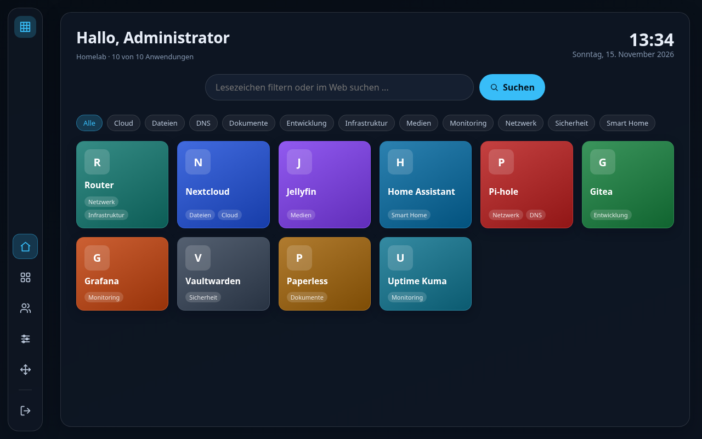
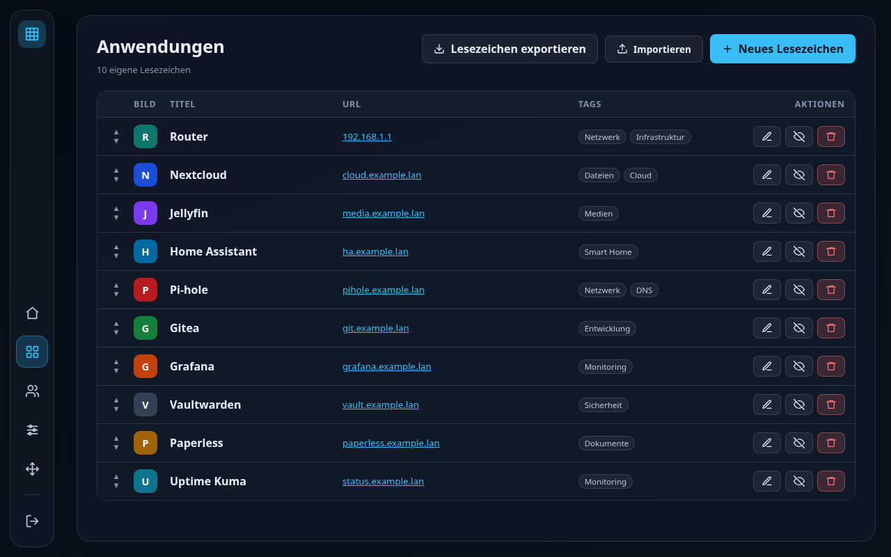
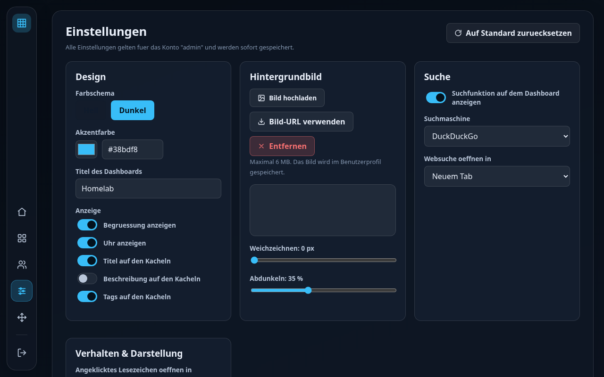
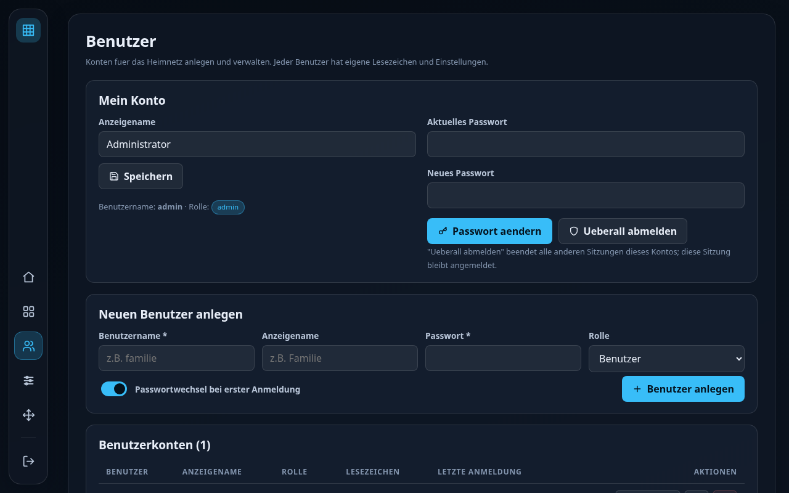

# Homelab Dashboard

Heimdall-artige Startseite fuer das Heimnetz: Lesezeichen als rechteckige Kacheln,
separate Konfigurationsseiten, Mehrbenutzerbetrieb mit Login und Admin-Panel,
MariaDB-Anbindung.

## Funktionsumfang

**Hauptseite (`#/home`)**

- Lesezeichen als Kacheln mit Bild bzw. Anfangsbuchstabe, eigener Hintergrund- und
  Schriftfarbe
- Optionale Suchleiste: filtert die Kacheln beim Tippen, per Enter Websuche mit der
  gewaehlten Suchmaschine
- Tag-Filter, Begruessung und Uhr (abschaltbar)
- Anordnung als Raster oder frei im Raum (Kacheln per Drag & Drop, Position in
  Prozent gespeichert)

**Anwendungen (`#/apps`)**

- Liste von oben nach unten mit Bild, Titel, URL, Tags und Aktionen
  (Bearbeiten, Loeschen, Deaktivieren, Reihenfolge verschieben)
- Bearbeitungsmodus mit Live-Vorschau der Kachel: Bild hochladen, Bild-URL
  verwenden oder Icons automatisch von der Zielseite holen
  (`<link rel="icon">`, `apple-touch-icon`, `og:image`, `/favicon.ico`)
- Hintergrundfarbe per Farbwaehler, Farbfeld oder Hex-Code; intern gespeicherte
  Beschreibung; Speichern / Loeschen / Abbrechen
- Import und Export der eigenen Lesezeichen als JSON

**Einstellungen (`#/settings`)**

- Design hell/dunkel, Akzentfarbe, Dashboard-Titel, Anzeigeoptionen
- Hintergrundbild (Upload oder URL) mit Weichzeichnen und Abdunkeln
- Suchfunktion ein/aus, Suchmaschine (inkl. eigener URL mit `{query}`), Zielfenster
- Verhalten beim Klick auf ein Lesezeichen (gleicher oder neuer Tab)
- Deckkraft und Milchglas-Effekt des Inhaltsrahmens als Schieberegler
- Export der eigenen Daten, Vollsicherung und Wiederherstellung (Administrator)

**Benutzer (`#/users`)**

- Eigenes Konto: Anzeigename und Passwort aendern
- Admin-Panel: Konten anlegen, Rolle wechseln, Passwort setzen, Wechsel erzwingen,
  Konten loeschen (der letzte Administrator bleibt geschuetzt)

Die senkrechte Toolbar unten links wechselt zwischen den Seiten, schaltet das
Anordnungs-Panel um und meldet ab.

## Screenshots

| Ansicht | Beschreibung |
|---|---|
|  | Startseite mit Kacheln, Suche und Tag-Filter. |
|  | Verwaltung der Lesezeichen. |
|  | Design, Suche und Anzeigeoptionen. |
|  | Benutzerverwaltung. |

Die Screenshots zeigen eine eigens angelegte Demo-Instanz mit Beispieldaten und Platzhalter-Adressen.

## Bedienung

1. Anmelden; beim ersten Login mit dem Startpasswort musst du ein neues Passwort setzen (siehe „Erst-Administrator“ weiter unten).
2. Unter **Anwendungen** Lesezeichen anlegen: Titel, Adresse, Tags, Farbe; Icon hochladen oder automatisch holen.
3. Auf der **Startseite** per Klick öffnen, per Suchleiste oder Tag filtern.
4. Unter **Einstellungen** Design, Titel, Suchmaschine und Anordnung anpassen; der Anordnungsmodus erlaubt freies Verschieben der Kacheln.
5. Administratoren legen unter **Benutzer** Konten an.

## Fehlersuche

- Keine Verbindung zur Datenbank: `STORAGE=auto` fällt auf den Datei-Speicher zurück; Hinweise im Container-Log (`docker compose logs`).
- Kein Schreibzugriff auf `data/`: Verzeichnis muss dem Container-Benutzer gehören (siehe Hinweis zur Persistenz weiter unten).
- Anmeldung nach Neustart ungültig: `SESSION_SECRET` fest setzen.

## Datenhaltung

`STORAGE` in der `.env` steuert den Speicher:

| Wert    | Verhalten                                                              |
| ------- | ---------------------------------------------------------------------- |
| `auto`  | MariaDB bevorzugt, bei Verbindungsproblemen Fallback auf `./data`       |
| `mysql` | ausschliesslich MariaDB (Start bricht bei Verbindungsfehler ab)        |
| `file`  | ausschliesslich Datei-Storage unter `./data/dashboard.json`            |

Datenbank und Tabellen (`users`, `bookmarks`, `settings`) werden beim Start
automatisch angelegt. Passwoerter werden mit scrypt gehasht, Sessions sind
HMAC-signierte HttpOnly-Cookies.

## Sessions

- **Laufzeit nach Client-IP:** Beim Login wird anhand der Client-IP
  entschieden, wie lange die Anmeldung gueltig bleibt: aus einem lokalen Netz
  (`LOCAL_NETWORKS`, Standard siehe `.env.example` - deckt private Netze,
  Loopback und **Tailscale** `DEINE_ADRESSE/10` ab) `SESSION_DAYS_LOCAL`
  (Standard 3650 Tage), sonst `SESSION_DAYS_REMOTE` (Standard 90 Tage). Die
  Laufzeit steht fest, sobald die Anmeldung erfolgt ist, und aendert sich
  waehrend der Sitzung nicht mehr.
- **Sliding Session:** Jede authentifizierte Anfrage verlaengert den Ablauf,
  das Cookie wird aber hoechstens einmal pro Stunde neu gesetzt (kein
  Set-Cookie bei jeder Anfrage).
- **Reverse Proxy:** `X-Forwarded-For` (Client-IP) und `X-Forwarded-Proto`
  (fuer das `Secure`-Cookie-Flag) werden nur ausgewertet, wenn die Anfrage
  direkt von einer IP aus `TRUSTED_PROXIES` kommt. Leer (Standard) = diese
  Header werden ignoriert, es zaehlt ausschliesslich die Socket-IP - das
  Dashboard laeuft dann z.B. hinter Tailscale weiterhin korrekt mit der
  echten Client-IP.
- **Serverseitige Invalidierung:** Jeder Benutzer hat eine `token_version`,
  die im signierten Session-Cookie steht. Sie wird erhoeht bei eigenem oder
  durch einen Administrator gesetztem Passwortwechsel, bei erzwungenem
  Passwortwechsel und bei einem Rollenwechsel - das meldet alle anderen
  Sitzungen dieses Kontos ab. Im eigenen Kontobereich (`#/users`) steht dafuer
  zusaetzlich der Knopf "Ueberall abmelden" bereit (diese Sitzung bleibt
  dabei angemeldet). Nach einem Update auf dieses Session-Format werden alte
  Sitzungscookies ungueltig - einmaliges Neuanmelden reicht, es gibt keinen
  Absturz.
- Session-Cookies sind `HttpOnly`, `SameSite=Lax` und erhalten `Secure`, wenn
  die Verbindung (direkt oder ueber einen Trusted Proxy) per HTTPS laeuft.

## Konfiguration

Alle Zugangsdaten stehen ausschliesslich in der `.env` (nicht in den
Compose-Dateien, nicht im Quellcode). Vorlage: `.env.example`.

Beim Erststart wird aus `ADMIN_USER` / `ADMIN_PASSWORD` ein Administrator
angelegt; das Passwort muss bei der ersten Anmeldung geaendert werden.

Neue Variablen fuer das Session-Verhalten (siehe oben): `SESSION_DAYS_LOCAL`,
`SESSION_DAYS_REMOTE`, `LOCAL_NETWORKS`, `TRUSTED_PROXIES` - alle optional,
Vorlage mit Standardwerten in `.env.example`. Die fruehere Variable
`SESSION_TTL_DAYS` wird nicht mehr ausgewertet; ein alter Eintrag in einer
bestehenden `.env` ist harmlos und kann entfernt werden.

## Schema-Migrationen

Sowohl MariaDB- als auch Datei-Storage fuehren beim Start automatisch alle
noch nicht angewendeten Migrationen aus (`server/store/migrations.js`), je
eine geordnete, idempotente Migration pro Schema-Version:

- MariaDB: Tabelle `schema_version` (Spalten `version`, `applied_at`); jede
  Migration laeuft in einer eigenen Transaktion (DDL wie `ALTER TABLE` bewirkt
  in MariaDB allerdings einen impliziten Commit).
- Datei-Storage: Feld `schemaVersion` in `data/dashboard.json`.

Schlaegt eine Migration fehl, meldet das Log die Ursache und der Dienst
startet nicht (kein halber Zustand) - das gilt fuer `STORAGE=mysql`, `file`
und `auto` (auch wenn die MariaDB-Verbindung an sich funktioniert, faellt
`auto` in diesem Fall **nicht** stillschweigend auf Datei-Storage zurueck).

## Version

Die aktuelle Version stammt aus `package.json` und erscheint in
`GET /api/health` (Feld `version`) sowie dezent am Ende der Einstellungsseite.

## Betrieb

- `docker-compose.yml` – Betrieb im Projektordner (Node-Image mit Bind-Mount),
  veroeffentlicht Port `3002`.
- `docker-compose.unraid.yml` – eigenstaendige Vorlage fuer unRaid: baut ein
  Image aus dem `Dockerfile` und ist von keinem Entwicklungsserver abhaengig.
  Projektordner nach `/mnt/user/appdata/homelab_dashboard` kopieren,
  `.env` anlegen und diese Datei als `docker-compose.yml` des Stacks verwenden.

Die Anwendung lauscht auf `0.0.0.0:3002`; Statusabfrage unter `/api/health`.

## Betrieb als Container (Image)

Vorbereitung fuer eine spaetere Veroeffentlichung als Container-Image (Stand 2026-11-14, lokal; es wurde **nichts gebaut oder veroeffentlicht**).

**Dateien:**

| Datei | Rolle |
|---|---|
| `Dockerfile` | Image: `node:20-alpine`, `npm ci --omit=dev` (Lockfile), Benutzer `node` (uid 1000), `HEALTHCHECK`, Volume `/app/data` |
| `.dockerignore` | Build-Kontext als Positivliste (nur `package*.json`, `server`, `public`); nie `.env*`, `data`, `*.sql`, `*.bak`, `node_modules`, Schluessel |
| `.github/workflows/release-image.yml` | Release-Workflow (aus der AppFactory-Vorlage): startet **nur** beim Push eines Tags `vX.Y.Z` (muss zur `package.json`-Version passen), baut `linux/amd64` und pusht `ghcr.io/homelabappfactory/homelab_dashboard:<tag>` plus `latest`; Rechte `contents: read`, `packages: write`. Es existiert noch kein Repository und es wurde nichts gebaut oder veroeffentlicht |
| `docker-compose.unraid.yml` | Container-Fassung: baut aus dem `Dockerfile`, Port `3002`, `./data:/app/data`, `env_file: .env` |
| `docker-compose.yml` | Entwicklungs-/AppFactory-Fassung (Node-Image mit Bind-Mount, laeuft als root, wird von der AppFactory fuer den laufenden Betrieb genutzt); **nicht** fuer ein Release-Image gedacht |
| `docker-compose.appfactory.yml`, `docker-compose.yml.bak` | Kopie bzw. alte Sicherung der Entwicklungsfassung; unveraendert, nicht loeschen |
| `datenbank.sql` | Export-Dump (Struktur/Stammdaten); die Anwendung legt Schema und Migrationen beim Start selbst an, der Dump ist fuer den Betrieb nicht noetig; nie in Image oder Repository |

**Start, Port, Health:** Port `PORT` (Standard `3002`), `HOST=0.0.0.0`. Health: `GET /api/health` ohne Anmeldung, Antwort `ok`, `storage` (`mariadb` oder Datei), `version`, `uptime` - keine Zugangsdaten. Der Docker-`HEALTHCHECK` ruft genau diesen Endpunkt auf.

**Persistenz:** Alle Schreibzugriffe der Anwendung liegen unter `DATA_DIR` (im Image `/app/data`): Datei-Storage `dashboard.json` (Fallback bzw. `STORAGE=file`), Session-Secret `session.secret` (nur wenn `SESSION_SECRET` fehlt oder kuerzer als 16 Zeichen ist). Das Image laeuft als Benutzer `node` (uid 1000): ein eingehaengtes Host-Verzeichnis muss ihm gehoeren (einmalig `chown -R 1000:1000 ./data`), sonst kann die Anwendung dort nicht schreiben. Ein bestehendes, root-eigenes `./data` wird von diesen Dateien **nicht** veraendert.

**Externe MariaDB (Vertrag laut Code, `server/config.js`, `server/store/mysql.js`):** Die MariaDB-/MySQL-Datenbank ist extern; die Compose-Dateien bringen keine mit. Variablen: `DB_HOST` (ohne Wert `127.0.0.1`), `DB_PORT` (`3306`), `DB_USER` (kein Standard), `DB_PASSWORD` (kein Standard), `DB_NAME` (Standard `homelab_dashboard_db`), `STORAGE` (`auto` | `mysql` | `file`). Beim Start fuehrt die Anwendung `CREATE DATABASE IF NOT EXISTS`, `CREATE TABLE IF NOT EXISTS` (`users`, `bookmarks`, `settings`) und die Schema-Migrationen aus; eine fehlgeschlagene Migration bricht den Start ab. Ob `CREATE DATABASE IF NOT EXISTS` fuer einen Benutzer ohne CREATE-Recht auf eine bereits vorhandene Datenbank scheitert, ist nicht geprueft. Ist die Datenbank nicht erreichbar, nutzt `STORAGE=auto` unveraendert den Datei-Storage. Geheimnisse (`DB_PASSWORD`, `SESSION_SECRET`, `ADMIN_PASSWORD`) nur in der `.env` bzw. als Umgebungsvariablen, nie im Image.

**Erst-Administrator:** Ohne `ADMIN_PASSWORD` legt die Anwendung `admin` mit dem Passwort `admin` an (Passwortwechsel beim ersten Login erzwungen); `ADMIN_PASSWORD` daher vor dem ersten Start setzen.

**Update, Backup, Restore, Rueckrollen:** Update = neues Image-Tag bzw. neu bauen; `.env`, `data/` und die Datenbank bleiben unberuehrt, Migrationen laufen beim Start. Backup = Datenbank mit dem eigenen Werkzeug (z. B. `mariadb-dump`) und `data/` bei gestopptem Container kopieren. Restore = beides zurueckspielen, Container starten. Rueckrollen auf eine aeltere Version nach einer Migration ist **nicht zugesichert**; vorher sichern.

## Update auf unRaid

1. Neuen Projektordner-Stand nach `/mnt/user/appdata/homelab_dashboard`
   kopieren - dabei `.env` und `data/` **nicht** ueberschreiben (beide
   enthalten Zugangsdaten bzw. die Fallback-Datenbank und bleiben unangetastet).
2. Container im Compose-Stack neu bauen und starten (Image stammt aus dem
   `Dockerfile`, s.o.).
3. Schema-Migrationen laufen beim Start automatisch gegen die bestehende
   Datenbank bzw. `data/dashboard.json` (siehe Abschnitt "Schema-Migrationen");
   es ist kein manueller Migrationsschritt noetig.
4. Bestehende Anmeldungen im alten Session-Format werden ungueltig - einmal
   neu anmelden genuegt.

## Mobile Nutzung

Das Dashboard ist responsiv (Breakpoints mobile-first per `max-width`: Phone
bis 480px, Tablet 481-900px, Desktop daruber unverandert):

- **Bottom-Navigation:** Auf Phone/Tablet wird aus der senkrechten Toolbar
  eine feste Navigationsleiste am unteren Bildschirmrand (volle Breite,
  gleichmaessig verteilte Icons, Safe-Area-Insets fuer Geraete mit Notch/Home-
  Indicator werden beruecksichtigt).
- **Raster-Erzwingung:** Die Anordnung "Frei im Raum" wird auf Phone/Tablet
  immer als Raster dargestellt (2 Spalten auf Phone, 3-4 auf Tablet); das
  Anordnungs-Panel und Drag & Drop sind dort ausgeblendet bzw. deaktiviert.
  Gespeicherte freie Positionen bleiben unveraendert in der Datenbank und
  werden auf dem Desktop weiterhin genutzt - es aendert sich nur die
  Darstellung.
- **Reihenfolge per Buttons:** Auf der Seite "Anwendungen" lassen sich eigene
  Lesezeichen mit den Pfeil-Buttons (hoch/runter) statt per Drag & Drop
  sortieren - das funktioniert auf allen Bildschirmgroessen und ist auf
  Touch-Geraeten die einzige Methode.
- **Bearbeitungsmodus ohne Live-Vorschau:** Auf Phone/Tablet wird beim
  Bearbeiten eines Lesezeichens die Kachel-Vorschau ausgeblendet, das
  Formular nutzt die volle Breite einspaltig (Desktop zeigt die Vorschau wie
  gewohnt).
- Listen, Dialoge, Einstellungen und das Admin-Panel passen sich an (gestapelte
  Karten, nahezu fullscreen-Dialoge auf Phone, Tabellen horizontal scrollbar)
  und alle Schaltflaechen haben mindestens 44x44px Tap-Flaeche.

## Freie Anordnung ("Frei im Raum")

Die gespeicherten Positionen (Prozentwerte je Lesezeichen) sind die alleinige
Wahrheit und werden ausschliesslich beim Ziehen und Loslassen einer Kachel
veraendert - nie durch Fenstergroesse oder den Raster-Fallback. Die Darstellung
entscheidet zur Laufzeit nach dem Alles-oder-nichts-Prinzip
(`public/js/freeLayout.js`, reine Funktion `fitsFreeLayout`, unit-getestet in
`tests/freeLayout.test.mjs`):

- **Alles oder nichts:** Passt das gespeicherte Layout bei der aktuellen
  Containergroesse komplett kollisionsfrei (Mindestabstand 8px) und innerhalb
  der Grenzen, wird es exakt wie gespeichert angezeigt. Sobald auch nur eine
  Kachel ueberlappen wuerde oder ueber den Rand hinausragt, schaltet die
  Darstellung fuer ALLE Kacheln auf dasselbe Raster wie auf Phone/Tablet um -
  keine Teilverschiebung einzelner Kacheln mehr, keine Luecken und kein
  kuenstlich vergroesserter, scrollender Container.
- **Blockade beim Ziehen:** Eine gezogene Kachel kann andere sichtbare Kacheln
  nicht ueberlagern; sie bleibt an der letzten freien Position stehen, bis der
  Mauszeiger wieder eine freie Flaeche erreicht. Das gilt nur im Freiform-Modus
  - im Raster-Fallback ist Drag & Drop deaktiviert.
- **Schwellwert `FREE_LAYOUT_MIN_WIDTH`** (`public/js/freeLayout.js`, Standard
  1000px Containerbreite, nicht Fensterbreite): darunter gilt das Layout immer
  als nicht passend, unabhaengig von der Geometrie. Darueber entscheidet
  ausschliesslich die Kollisions-/Randpruefung. Die Mobile-Regeln selbst (siehe
  oben) sind davon unberuehrt.
- **Kein Flackern am Fensterrand:** Bei jeder Groessenaenderung (gedrosselt auf
  ca. 100ms) wird neu geprueft, ob das Layout noch passt. Ein vom aktuellen
  Modus abweichendes Ergebnis wird erst uebernommen, wenn es sich ueber zwei
  aufeinanderfolgende Messungen bestaetigt oder sich die Breite seit dem
  letzten Wechsel um mindestens 16px geaendert hat.
- **Hinweis:** Ist der Raster-Fallback wegen des Freiform-Layouts aktiv,
  erscheint ein dezenter, wegklickbarer Hinweis unter den Kacheln (pro
  Browser-Sitzung nur einmal). Hat der Benutzer ohnehin "Raster" eingestellt
  oder ist der Bildschirm Phone/Tablet, erscheint er nicht.

## Tests

`npm test` fuehrt `tests/freeLayout.test.mjs` (Node-eigener Testrunner, keine
zusaetzliche Abhaengigkeit) gegen `public/js/freeLayout.js` aus: `fitsFreeLayout`
auf Kollisionsfreiheit, Randueberschreitung, Determinismus, Randfall genau am
Mindestabstand und dass Eingaben nicht mutiert werden; dazu `rectsOverlap` fuer
die Drag-Blockade.

## Als Startseite des Browsers

Adresse des Dashboards (z. B. `http://10.10.50.x:3002`) in den
Browser-Einstellungen als Startseite bzw. Seite fuer neue Tabs eintragen.
Die Einstellungsseite zeigt die Adresse an und kopiert sie auf Wunsch.

## Download

Über **Code → Download ZIP** oder unter **Releases** auf GitHub.

## Lizenz

Siehe die Datei `LICENSE` im Projekt.

---

## English summary

Homelab Dashboard is a start page for your home network: bookmarks as tiles with search and tags, multi-user login, light/dark design, MariaDB or file storage. Runs as a Docker container (`docker-compose.unraid.yml`, port 3002).
